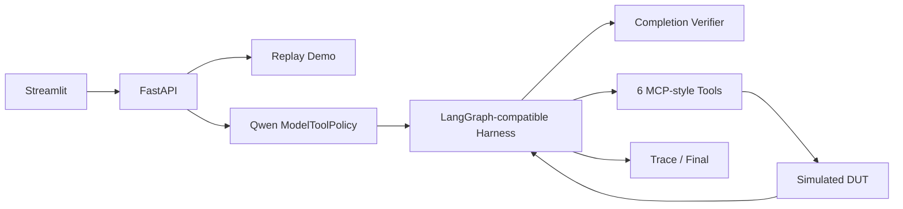

# AutoFault-Agent 🚗

[中文](#中文) · [English](#english)

## 中文

AutoFault-Agent 是一个个人独立研究与工程项目，探索基于 Qwen3-4B、LoRA-SFT、MCP 风格工具与 Completion Verifier 的汽车故障测试 Agent。公开版本只操作内存中的合成 DUT，不连接真实车辆或物理测试设备。

### 架构与流程



Live 模式中，模型读取用户目标，自主生成工具调用，轻量 Harness 执行安全合成工具并返回 Observation，模型继续决策。公开版 Completion Verifier 面向三个公开全流程 Demo，检查六类动作与恢复后置条件并返回不含答案的有限反馈；它不会替模型选择或执行工具。原研究项目还包含按 task type 区分的完整 Contract、合法 BLOCKED 与 overcontinue 审计，这些评估逻辑没有被包装成公开 Demo 能力。

六种工具：故障知识检索、测试用例获取、合成故障注入、DTC 读取、结果判定和故障恢复。页面显示真实 Trace 顺序，不强制播放固定六步。

### SFT 与 Stop/Continue

Qwen3-4B LoRA-SFT 使用 assistant-only loss masking：system、user、工具 Observation 和 padding 不计算 loss。SFT-A 使用完整专家轨迹；SFT-B 额外加入 Stop/Continue 决策监督，仅监督正确的下一步 assistant 决策，并屏蔽历史错误输出。模型权重和 Adapter 不随仓库发布。

### Phase 5C 独立封存评测

每组 144 条任务，覆盖 8 个独立合成 fault_id：

| 条件 | Strict Task Success |
|---|---:|
| Base OFF | 62/144 (43.1%) |
| Old SFT OFF | 44/144 (30.6%) |
| SFT-A OFF | 46/144 (31.9%) |
| SFT-B OFF | 124/144 (86.1%) |
| Base ON | 72/144 (50.0%) |
| SFT-B ON | 143/144 (99.3%) |

首要比较 SFT-B OFF − SFT-A OFF 为 +54.2 个百分点，task-paired bootstrap 95% CI [45.8, 62.5]。Verifier-assisted success 是运行时纠正效果，不等于模型原生能力。

这些结果只证明同一合成领域和工具体系内的泛化；144 条任务仅来自 8 个故障组，不能解释为真实车辆测试效果。

### 快速开始：CPU Replay

```bash
git clone <your-repository-url>
cd AutoFault-Agent-Public
python -m venv .venv
source .venv/bin/activate
pip install -e '.[test]'
uvicorn api.main:app --host 127.0.0.1 --port 8000
```

Replay UI 可以单独启动，不需要 API：

```bash
source .venv/bin/activate
streamlit run ui/streamlit_app.py
```

打开 `http://127.0.0.1:8501`。Replay 页面直接读取包内公开场景与轨迹，不需要 FastAPI、GPU 或模型权重。只有 Live 模式才调用 `AUTOFAULT_API_URL` 指向的 FastAPI 服务。

### GPU Live

```bash
pip install -r requirements-live.txt
export CUDA_VISIBLE_DEVICES=<physical-gpu-id>
export AUTOFAULT_LIVE_ENABLED=true
export AUTOFAULT_API_TOKEN='<long-random-secret>'
export AUTOFAULT_MODEL_PATH='/local/path/to/Qwen3-4B'
export AUTOFAULT_SFT_ADAPTER_PATH='/local/path/to/sft-b-checkpoint-90'
uvicorn api.main:app --host 127.0.0.1 --port 8000
```

Live 默认关闭。API 在加载模型前检查本地文件、单卡 CUDA 映射和至少 18,000 MiB 空闲显存，并提供认证、限流、超时与并发限制。

截图/GIF 位置：发布前把经过人工审阅、无路径和凭据的媒体放入 `docs/assets/`。

### 许可与路线图

代码及新建公开合成样本采用 Apache-2.0。Qwen 权重不在仓库中分发，须从官方渠道独立取得并遵守其模型许可。依赖软件适用各自许可证。

路线图：增加更多独立公开合成故障组、完善可观测性、实现可选 LangGraph runtime adapter、在新的预注册测试集上复核泛化。不会用 Phase 5C 封存失败样本继续调参。

## English

AutoFault-Agent is a personal research and engineering project for model-driven synthetic automotive fault testing with Qwen3-4B, LoRA-SFT, MCP-style tools and a Completion Verifier. The public release controls only an in-memory simulated DUT; it never connects to a real vehicle.

In Live mode, the agent follows a model → tool → observation → model loop. Its six allowlisted tools cover knowledge retrieval, test-case lookup, synthetic injection, DTC reading, result judgment and recovery. The public verifier is a reduced full-workflow checker for the three public demo scenarios; it may return bounded, non-answer feedback and never executes missing actions for the model. The richer task-type-specific contracts used in the private evaluation are not represented as public demo capability.

SFT-A learns from full expert trajectories. SFT-B adds Stop/Continue supervision while masking historical incorrect assistant actions. In the preregistered Phase 5C synthetic evaluation, SFT-B OFF achieved 124/144 strict successes (86.1%) versus SFT-A OFF 46/144 (31.9%). These are synthetic-domain results across only eight independent fault groups, not real-vehicle performance claims.

Use the CPU Replay commands above for a public deployment. Replay requires no model files. Live mode is private-by-default and requires explicit enablement, authentication, a local Qwen3-4B checkout, an optional SFT-B adapter, exactly one visible CUDA device and memory preflight. See [deployment](docs/DEPLOYMENT.md), [architecture](docs/ARCHITECTURE.md), and the [security audit](docs/OPEN_SOURCE_SECURITY_AUDIT.md).

Model weights, adapters, sealed tests, Oracle data, training caches and private experiment traces are intentionally excluded. Code and newly authored public synthetic examples are Apache-2.0 licensed; upstream models and dependencies retain their own licenses.
