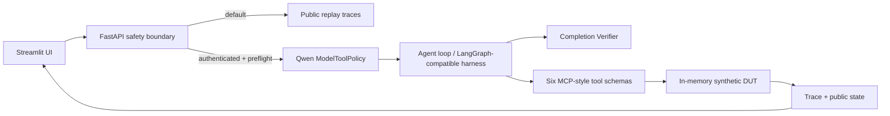

# Architecture

Replay and Live share the public result schema. Replay never imports Transformers or Torch. Live requires an explicit environment switch, bearer token, exactly one visible CUDA device, at least 18,000 MiB free memory, local model files, request timeout and concurrency limit.

The six tools are retrieval, test-case lookup, fault injection, DTC reading, result judgment and recovery. Tool order is chosen by the model in Live mode; the UI renders the trace it receives and never manufactures a fixed six-step execution.

The original research harness used a LangGraph-oriented agent organization and MCP-compatible tools. The public package does **not** ship a LangGraph runtime or MCP server: it keeps the same model → tool → observation → decision pattern with a lightweight async harness and MCP-style JSON schemas. Its verifier is deliberately reduced to the three public full-workflow scenarios; private task-type contracts, legal-BLOCKED scoring and evaluation Oracle logic are not exposed.
